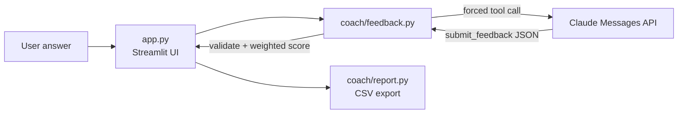

# AI Interview Coach

[](https://github.com/aryaniftikhar05-droid/Ai-interview-Coach/actions/workflows/ci.yml)
[](https://www.python.org/)
[](https://streamlit.io/)
[](https://docs.claude.com/)

<!-- After deploying on Streamlit Community Cloud, add: **Live demo:** https://YOUR-APP.streamlit.app -->
**Run it yourself:** see [Run locally](#run-locally) (about 2 minutes) or
[Deploy on Streamlit Community Cloud](#deploy-on-streamlit-community-cloud).

A Streamlit app for practising machine learning engineer and data scientist
interview questions. You answer a question, Claude scores it against a rubric,
and the app explains the main gap, shows a stronger approach and asks the
follow-up question a real interviewer would ask next.


## Features

- 34 questions across Technical, System Design, Case Study and Behavioural
  categories, or paste your own question from a real job advert
- Rubric scores for structure, technical depth, examples and communication
- **Follow-up questions**: answer the interviewer's next question in one click,
  like a real interview loop
- Weighted overall score calculated in the app, not by the model
- Progress tab with a per-criterion chart for the session
- CSV export of scores (answer text is never exported)

## Engineering decisions

- **Structured output through tool use.** The request forces Claude to answer
  with a `submit_feedback` tool that has a JSON schema (score ranges, required
  fields, allowed decisions). This removes fragile parsing of free text.
- **Never trust the model blindly.** Every field is validated again in Python,
  and the weighted score is computed locally so the model cannot change the
  weighting or invent an overall score.
- **Separation of concerns.** `coach/` holds the logic and has no Streamlit
  imports, so it can be unit-tested; `app.py` is only the interface.
- **Tested without network calls.** The HTTP function is injected, so tests use
  a fake API to check the request shape, validation and error handling (401,
  429, 5xx, timeouts). A Streamlit `AppTest` smoke test loads the full app.
- **Safe defaults.** Clear user-facing errors, no fake score when a request
  fails, secrets kept out of the repo, and CSV cells protected against
  spreadsheet formula injection.



## Project structure

```
app.py               Streamlit interface
coach/feedback.py    API request, tool schema, validation, scoring
coach/questions.py   Question bank
coach/report.py      CSV export
tests/               Unit tests and an app smoke test (pytest)
```

## Run locally

Requires Python 3.10+ and an Anthropic API key.

```bash
python -m venv .venv && source .venv/bin/activate
python -m pip install -r requirements-dev.txt
```

Create `.streamlit/secrets.toml` (excluded by `.gitignore`):

```toml
ANTHROPIC_API_KEY = "your-api-key"
# Optional: choose a different Claude model
# ANTHROPIC_MODEL = "claude-sonnet-5-5"
```

You can also set these as environment variables. Then run:

```bash
python -m streamlit run app.py
python -m pytest -q        # run the tests
```

## Deploy on Streamlit Community Cloud

1. Sign in at [share.streamlit.io](https://share.streamlit.io) with GitHub.
2. Select **Create app**, choose this repository, branch `main`, file `app.py`.
3. Open **Advanced settings → Secrets** and add `ANTHROPIC_API_KEY = "your-api-key"`.
4. Select **Deploy**. Never put the key in source code.

## Data and limitations

- Answers are sent to Anthropic's API. Do not submit passwords, sensitive
  personal data or confidential information.
- History lives only in the Streamlit session; nothing is stored permanently.
- Model feedback can be inaccurate or inconsistent. Scores and the practice
  decision are prompts for reflection, not a validated hiring assessment.

## Ideas for next steps

- Evaluate scoring consistency: grade the same answers several times and report
  the variance, and compare against a small set of human-graded answers
- Tailor questions to a pasted job description
- Voice answers with speech-to-text for spoken-interview practice

## Technologies

Python, Streamlit, Requests, Anthropic Messages API (tool use), pytest,
GitHub Actions.
